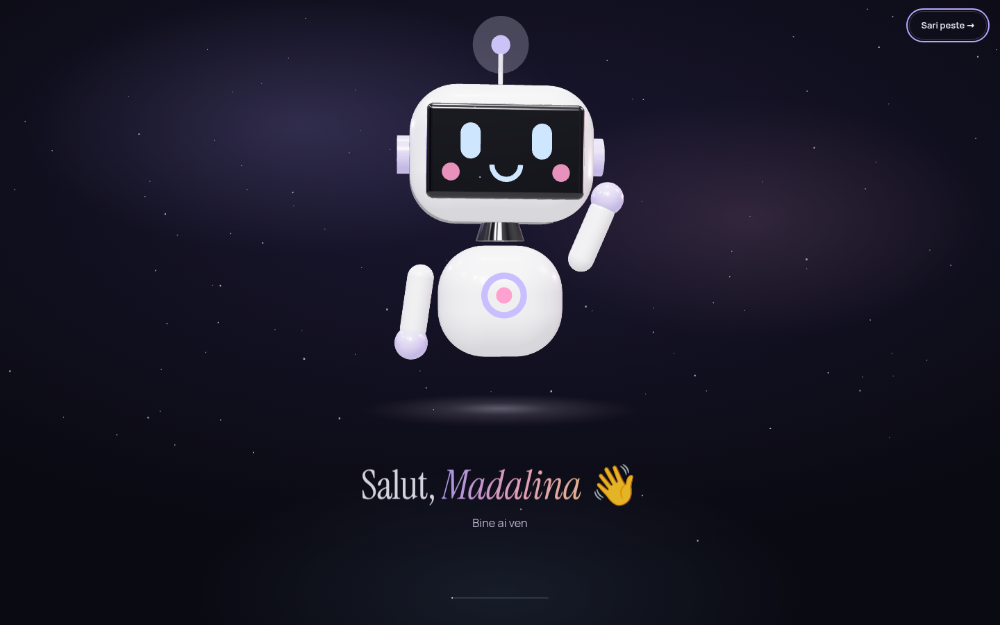
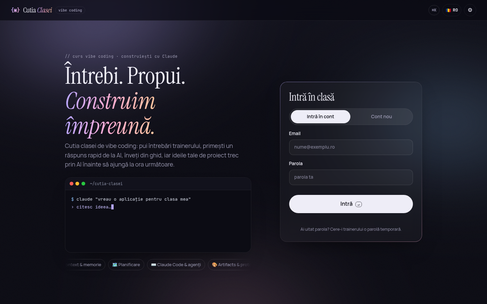
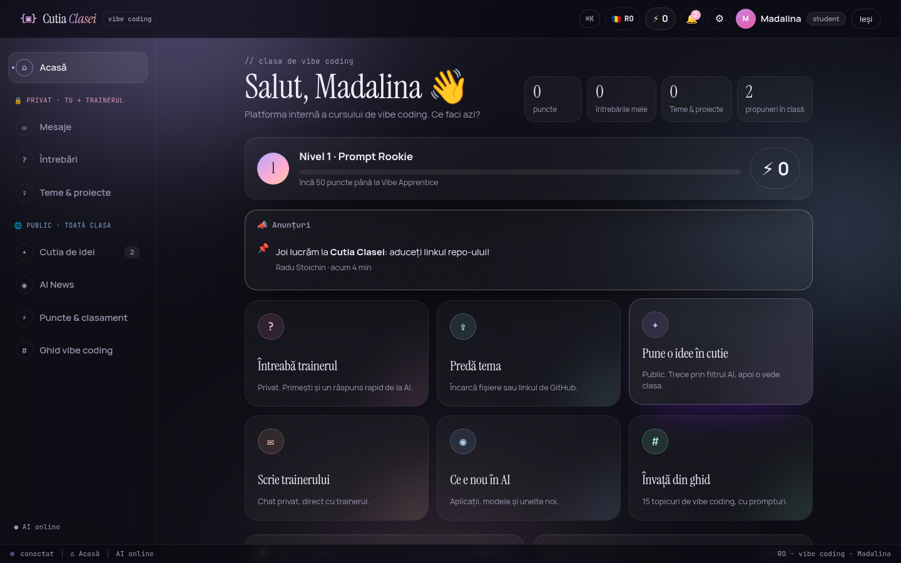
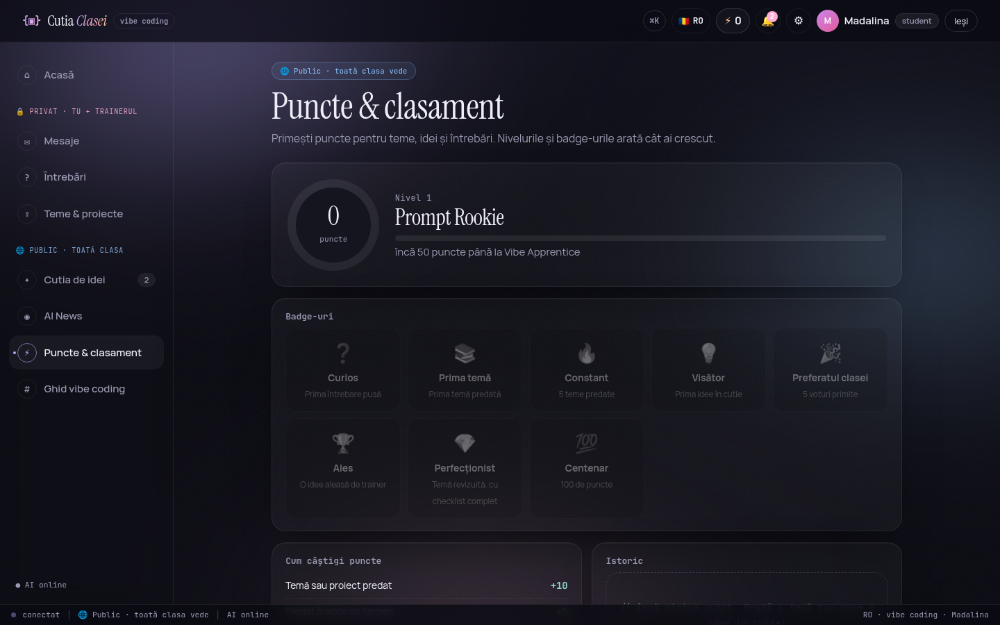
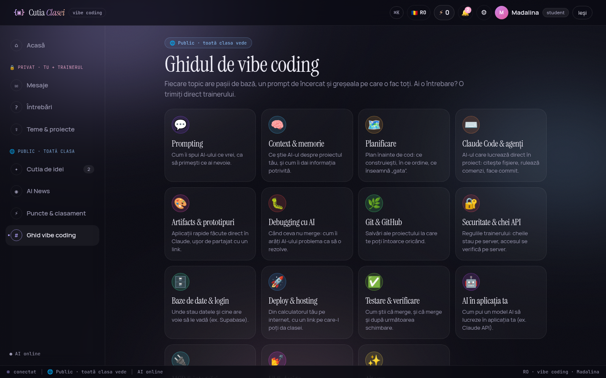
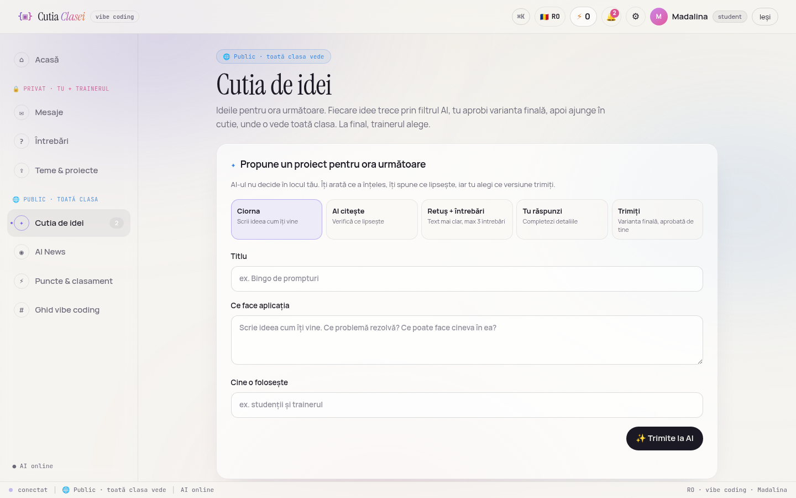
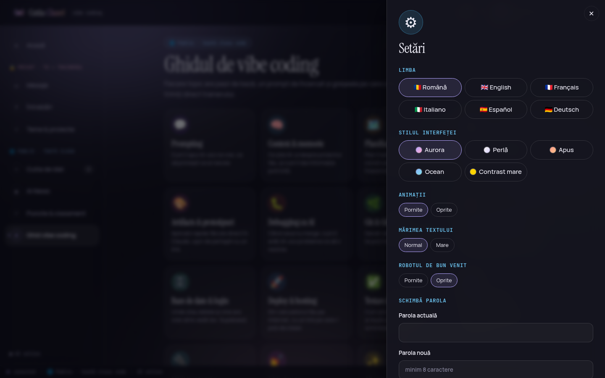
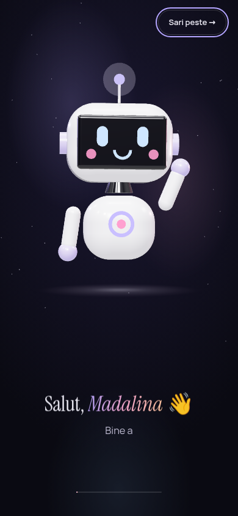

# {▣} Cutia Clasei

**Platforma internă a cursului de vibe coding.** Fiecare student are un spațiu privat cu trainerul (mesaje, întrebări, teme), iar clasa are un spațiu public (cutia de idei cu filtru AI, AI News, clasament, ghid). Interfața merge în **6 limbi** (RO, EN, FR, IT, ES, DE), are un design elegant „Aurora” (5 stiluri vizuale) și un **robot 3D** care te salută pe nume când intri.



## De unde vine

Aplicația finală a clasei combină cele mai bune idei din temele studenților:

- **Madalina**: baza aplicației (server, design „Aurora”, ora live, puncte, AI News, Atelier, toate cele 6 limbi).
- **Alexandra**: diff pe cuvinte la retușul AI, FAQ publicat doar cu acordul studentului, mod proiector, export CSV, mod demo.
- **Andrei**: statusurile propunerilor (Nouă, În discuție, Aleasă, Respinsă) cu notă publică și limita de retușări AI.

## Ce face aplicația

| Spațiu | Ce găsești |
| --- | --- |
| 🔒 **Privat** (doar tu și trainerul) | **Mesaje directe:** chat privat cu trainerul. **Întrebări:** pe topicuri, cu răspuns rapid de la AI și răspunsul oficial al trainerului. **Teme & proiecte:** predai fișiere, linkul GitHub și checklist-ul temei, pentru temele anunțate de trainer (cu termen); primești feedback. **Atelier:** Verifică repo-ul, Error Doctor, Prompt Lab. |
| 🌐 **Public** (toată clasa) | **Ora live:** „M-am blocat” anonim, vot rapid, întrebări cu ▲, bilet de ieșire. **Cutia de idei:** AI-ul retușează ideea și cere detalii doar unde lipsesc; tu aprobi; clasa votează; trainerul alege; ideea aleasă primește un kit de start. **Demo Day:** aplicațiile terminate ale clasei. **AI News:** briefing-ul zilei de la Byte + știri filtrate. **Puncte & clasament:** niveluri, badge-uri, serii, misiuni săptămânale. **Ghid de vibe coding:** 15 topicuri, întrebări frecvente, Hall of Prompts. |

### Minimul obligatoriu

| Funcție | Cum e implementată |
| --- | --- |
| Pune o întrebare | O văd doar studentul care a pus-o și trainerul (verificat pe server). |
| Răspuns | Trainerul răspunde (sau editează), studentul vede răspunsul. |
| Scrie o propunere | Titlu, ce face aplicația, cine o folosește. |
| Modul AI | Arată ce a înțeles, retușează textul și pune **maxim 3 întrebări**, doar despre ce lipsește: problema, funcțiile, datele, mărimea. |
| Trimite propunerea | Studentul bifează „Am citit și aprob” înainte de trimitere; orice editare cere o nouă aprobare. Serverul refuză propunerile neaprobate. |
| Trainerul alege | Trainerul vede toate propunerile și le pune un status: Nouă, În discuție, Aleasă sau Respinsă, cu o notă pe care o vede clasa. |

### Funcții în plus

- **Ce a schimbat AI-ul:** după retuș, studentul vede descrierea lui și varianta AI una peste alta, cuvânt cu cuvânt: tăiat = scos, evidențiat = adăugat.
- **FAQ cu acord:** la fiecare întrebare, studentul bifează dacă poate apărea anonim în FAQ (și își poate retrage acordul oricând, iar intrarea dispare). Trainerul publică în FAQ doar întrebările cu acord, fără nume.
- **Statusuri pentru propuneri:** Nouă, În discuție, Aleasă, Respinsă, plus o notă publică a trainerului. Autorul primește notificare la fiecare schimbare.
- **Mod proiector:** trainerul arată propunerile pe ecran mare, una câte una, în ordinea voturilor (← → și Esc).
- **Export CSV:** toate propunerile, cu voturi și status, într-un fișier care se deschide în Excel.
- **Limită de retușări AI:** fiecare student are maximum 20 de retușări cu Claude pe zi (`CUTIA_REFINE_PER_DAY`), ca să ții costul sub control.
- **Mod demo:** cu `CUTIA_DEMO=1`, aplicația pornește cu un trainer, doi studenți, întrebări și propuneri fictive. Conturile apar pe pagina de intrare.

- **Robotul de bun venit (3D):** un robot construit în Three.js urcă pe ecran, îți face cu mâna, te urmărește cu privirea și îți spune „Salut, Madalina!”. După 7 secunde se deschide interfața (sau apeși „Sari peste”). Se poate opri din Setări și nu apare dacă ai animațiile oprite.
- **Propunerile mele:** trimiți câte propuneri vrei și le vezi pe toate într-un loc. O propunere se poate **retrage** (de exemplu „✓ Am rezolvat problema”, cu un mesaj opțional): iese din cutia publică, dar autorul și trainerul o văd în continuare, iar autorul o poate pune înapoi oricând.
- **Ciorne:** propunerile la care lucrezi se salvează automat pe server (cel mult 20 per student), le continui oricând din „Ciornele mele”. Textul nescris din întrebări, mesaje și teme rămâne în browser până îl trimiți și se șterge la „Ieși”, ca să nu-l vadă următorul pe un calculator comun.
- **Atelier** (🔒 privat), trei unelte pentru student:
  - **Verifică repo-ul:** lipești linkul de GitHub și primești lista „Gata când” a trainerului bifată automat: README cu „ce face / cum se pornește / funcții în plus”, link live, `.env` în `.gitignore`, niciun `.env` urcat și **nicio cheie API în cod sau în istoricul commiturilor** (cheile găsite apar mascate, cu sfatul să le regenerezi). Butonul apare și la predarea temei, iar trainerul îl are la fiecare temă cu link GitHub.
  - **Error Doctor 🩺:** lipești o eroare sau o captură de ecran (și cu Ctrl+V); primești ce înseamnă, cauza probabilă, pașii și promptul gata de pus în Claude Code. Cheile API lipite din greșeală se ascund înainte de orice. Fără AI recunoaște cele mai dese 12 tipuri de erori.
  - **Prompt Lab 🧪:** notează promptul pe 4 criterii (context, obiectiv, reguli, exemple), dă sfaturi și o variantă mai bună; cele mai bune ajung în **Hall of Prompts** (public, în Ghid), cu ♥.
- **Ora live 🔴:** trainerul pornește ora; studenții văd „LIVE” în meniu și primesc notificare. Butonul **„🙋 M-am blocat”** e anonim (trainerul vede doar câți sunt), **vot rapid** cu rezultate după ce votezi, **coada de întrebări** (și anonime) cu ▲, iar la final **biletul de ieșire** (răspunsurile le vede doar trainerul). După oră, clasa e trimisă spre Cutia de idei.
- **Demo Day ★:** aplicațiile terminate, cu link live, repo și captură; colegii reacționează (🔥👏💡🤯), trainerul alege **proiectul săptămânii**. +10 puncte per proiect (max 3), +25 pentru proiectul săptămânii.
- **Kit de start 🚀:** la o idee aleasă de trainer: primul prompt de pus în Claude, planul pentru prima oră, ce urmează și lista „Gata când”.
- **Serii și misiuni săptămânale:** 🔥 zile la rând în care ai lucrat, plus 4 misiuni pe săptămână (aceleași pentru toată clasa, altele în fiecare săptămână), +5 puncte fiecare. Badge-uri noi: „De neoprit” (7 zile) și „Maestrul misiunilor”.
- **Recap-ul săptămânii (trainer):** pe Acasă, cifrele ultimelor 7 zile, subiectele, cine n-a mai intrat și, cu AI, un rezumat și ce merită reluat la ora următoare. La Claude ajung doar textele întrebărilor și răspunsurilor, niciodată nume.
- **Întrebări frecvente:** trainerul publică răspunsuri (și din propunerile recap-ului); toată clasa le vede în Ghid.
- **Aplicație pe telefon 📲:** se instalează pe ecranul principal (Android, iPhone, calculator), se deschide și fără internet (ultima versiune), cu **notificări push**: răspunsul trainerului, mesaje, feedback, idee aleasă, temă nouă, ora live, briefing-ul lui Byte. Notificările sunt în limba fiecăruia, fără conținut privat pe ecranul blocat.
- **Conturi cu email + parolă:** fiecare student își face singur contul („N-ai cont? Creează-ți unul”: nume, email, parolă) și intră direct ca student. Trainer e doar `stoichin.radu23@gmail.com` (`TRAINER_EMAILS`), cu codul de trainer la prima înscriere. Din **Puncte → 👥 Studenții clasei** trainerul poate face și el conturi, îi redenumește, le pune o parolă nouă sau le șterge contul.
- **Numele tău, automat:** sesiunea rămâne activă (și după repornirea serverului). Aplicația te salută pe nume peste tot, iar la revenire îți spune „Bine ai revenit, Madalina!”.
- **Mesaje directe** student ↔ trainer, cu mesaje necitite și notificări.
- **Teme anunțate de trainer** cu termen, puncte și numărătoare inversă; **anunțuri** fixate pe pagina de acasă.
- **Credite & puncte bonus:** puncte pentru teme (+10), predare la timp (+5), temă revizuită (+20 sau cât stabilește trainerul), idei (+5), voturi primite (+2), idee aleasă (+30), întrebări (+2, max 3/zi) și bonusuri de la trainer. 6 niveluri (Prompt Rookie → AI Wizard), 8 badge-uri, podium și clasament (poți alege să nu apari).
- **Byte, robotul de știri 🤖 (briefing-ul zilei):** o dată la 24 de ore (implicit la 07:00, ora României) Byte citește toate sursele și păstrează ce a apărut în ultimele 24 de ore. Cu cheie API, Claude scrie briefing-ul pentru clasă:
  - un titlu și un rezumat al zilei;
  - 5–7 știri, fiecare cu „de ce contează” și „💡 pentru tine” (ce poți încerca sau construi cu ea);
  - **unealta zilei**, cu un prompt gata de copiat în Claude;
  - o **provocare de 15 minute** cu 3 pași de bifat;
  - **cuvântul zilei** și **pulsul zilei** (cât de mare a fost ziua în AI).

  Byte arată câte surse și câte știri a citit, iar briefing-ul se poate **asculta** (citit cu voce în limba ta), copia pentru grupul clasei sau răsfoi pe zilele trecute. Primești notificare când e gata. Trainerul îl poate face din nou oricând.

  Claude alege știrile doar din listă, iar linkurile le punem noi din surse, deci nu poate inventa știri. Fără cheie, Byte face un briefing din scorul știrilor, iar provocarea vine din ghid.
- **AI News:** știri din surse publice despre AI (TechCrunch, The Verge, MIT Technology Review, Ars Technica, VentureBeat, Wired, The Decoder, Hugging Face, Google AI, Google DeepMind, OpenAI, GitHub Blog, Latent Space, Simon Willison, Hacker News), filtrate după relevanță (aplicații noi, modele, unelte, „wow”), pe categorii. Cu cheie API, Claude alege cele mai bune și explică „de ce contează” în limba ta. Din orice știre: „Trimite trainerului” sau „Fă o idee din asta”.
- **Răspuns rapid de la AI** la fiecare întrebare, marcat „neverificat de trainer”.
- **6 limbi** (RO, EN, FR, IT, ES, DE): interfață, erori de server, texte AI și ghid. Limba aleasă te urmează pe orice dispozitiv.
- **Design „Aurora”:** fundal adânc cu lumini de auroră discrete și grăunte fin de film, titluri în serif elegant (Instrument Serif), text în Manrope, butoane calme în formă de pastilă. 5 stiluri: Aurora, Perlă (luminos), Apus, Ocean, Contrast mare. Plus animații pornite/oprite și text normal/mare.
- **Ușor de folosit:** pagină de acasă cu acțiuni rapide, tur de bun venit la prima intrare, notificări 🔔, paleta de comenzi `Ctrl+K` (mergi oriunde, schimbi limba sau stilul), `/` pentru căutare, `Ctrl+Enter` pentru trimitere, meniu jos pe telefon.

| Login | Acasă | Puncte & clasament |
| --- | --- | --- |
|  |  |  |

| Ghidul | Cutia de idei (stilul Perlă) | Setări | Telefon |
| --- | --- | --- | --- |
|  |  |  |  |

## Publică pe Vercel (linkul live)

Aplicația e gata pentru [Vercel](https://vercel.com): `app.py` (intrarea FastAPI), `vercel.json` (durata maximă și Cron-ul zilnic pentru Byte). Datele și fișierele stau în **Supabase** (pe Vercel nu există disc permanent).

### 1. Supabase (baza de date, gratuit)

1. Fă-ți cont pe [supabase.com](https://supabase.com) și creează un proiect (regiunea *Frankfurt*, aproape de România și de Vercel).
2. **SQL Editor** → lipește tot conținutul din `supabase/schema.sql` → **Run**. Se creează tabelul `cutia_state` (Row Level Security fără politici: browserul nu poate citi nimic), funcțiile `cutia_sync` / `cutia_commit` și bucket-ul privat `cutia-files`. Poți rula fișierul din nou oricând.
3. **Project Settings → API Keys**: copiază *Project URL* și cheia **secret** (`sb_secret_…`). Cheia secretă stă doar în Vercel, niciodată în cod sau pe GitHub.

### 2. Vercel

1. Fă-ți cont pe **vercel.com** cu GitHub → **Add New → Project** → alegi acest repo.
2. **Root Directory: `cutia-final`** (important: aplicația e în acest folder). Framework: FastAPI (îl recunoaște singur).
3. La **Environment Variables** pune:

| Variabilă | Obligatoriu | Ce pui |
| --- | --- | --- |
| `TRAINER_EMAILS` | da | Emailul tău (sau mai multe, separate prin virgulă). |
| `TRAINER_CODE` | da | Un cod secret de minim 6 caractere. Îl folosești o dată, când îți faci contul de trainer. |
| `SUPABASE_URL` | da | *Project URL* din Supabase. |
| `SUPABASE_SECRET_KEY` | da | Cheia `sb_secret_…` din Supabase. |
| `CRON_SECRET` | da | Un șir lung, aleatoriu. Vercel îl trimite la Cron, ca nimeni altcineva să nu pornească briefing-ul. |
| `ANTHROPIC_API_KEY` | nu | Activează AI-ul. Fără ea aplicația merge în modul local. |
| `SESSION_SECRET` | nu | Cheia cu care se semnează sesiunile. Implicit e derivată din cheia Supabase. |
| `VAPID_PUBLIC_KEY` / `VAPID_PRIVATE_KEY` / `VAPID_SUBJECT` | nu | Notificări push (`python -m src.webpush` le generează). |
| `GITHUB_TOKEN` | nu | Token doar de citire pentru „Verifică repo-ul” (limita GitHub urcă de la 60 la 5000 de cereri pe oră). |

4. **Deploy**. După ~1 minut primești linkul (`https://cutia-clasei-….vercel.app`).
5. Deschide linkul: prima dată apare **„Contul de trainer”**. Scrii numele, emailul din `TRAINER_EMAILS`, o parolă și `TRAINER_CODE`. Gata, ești trainer.
6. **Puncte → 👥 Studenții clasei**: adaugi fiecare student (utilizator, nume afișat, parolă generată) și îi trimiți datele de intrare cu butonul **Copiază**.

De aici, fiecare `git push` publică automat versiunea nouă.

**Ce e diferit pe Vercel:**
- Serverul rulează în mai multe copii în același timp. Fiecare cerere citește din Supabase doar ce s-a schimbat și scrie doar ce a schimbat ea; dacă două copii scriu deodată, a doua își reia cererea pe datele noi, deci nu se pierde nimic.
- **Byte** (briefing-ul zilei) îl pornește Vercel Cron o dată pe zi (`vercel.json`, în jur de 08:15 vara / 07:15 iarna, ora României). Trainerul îl poate face oricând din AI News.
- O cerere are maxim ~4,5 MB, deci **o predare are cel mult 4 MB de fișiere** în total (aplicația spune asta înainte de încărcare).
- **Cost: 0** pe planurile gratuite Vercel (Hobby) și Supabase. Proiectele Supabase gratuite se pun pe pauză după o săptămână fără activitate; le repornești din panoul Supabase.

## Cum se pornește local

```bash
pip install -r requirements-dev.txt
cp .env.example .env          # pune TRAINER_EMAILS și TRAINER_CODE (și, opțional, cheia API)
uvicorn src.app:app --reload
```

Deschide http://localhost:8000. Fără `SUPABASE_*`, datele se salvează local în `data/cutia.json`. Cu `SUPABASE_*` în `.env`, local folosești aceeași bază de date ca pe Vercel.

- **Trainerul:** prima dată, „Contul de trainer” (email din `TRAINER_EMAILS` + parolă + `TRAINER_CODE`). Apoi intră cu emailul și parola.
- **Studenții:** își fac cont cu **emailul și o parolă**, apoi intră cu ele. Parola o pot schimba din Setări.
- **Ai uitat parola?** Trainerul îți pune una nouă din Puncte (🔑 Parolă nouă sau 🔑 Parolă temporară).
- **Fără cheie API** aplicația merge complet: propunerile se retușează local, la întrebări apar sfaturi din ghid, iar știrile sunt filtrate automat.

| Variabilă (în plus față de cele de mai sus) | Implicit | Rol |
| --- | --- | --- |
| `CUTIA_AI` | `auto` | `auto` / `on` / `off` |
| `CUTIA_REFINE_PER_DAY` | `20` | Câte retușări cu Claude are un student pe zi. |
| `CUTIA_DEMO` | `0` | `1` = conturi și date fictive pentru prezentare. Doar fără Supabase și doar pe o bază goală. |
| `CUTIA_MODEL` | `claude-sonnet-5-5` | Modelul Claude. |
| `CUTIA_DATA` / `CUTIA_UPLOADS` | `data/…` | Unde se salvează datele local, fără Supabase. |
| `CUTIA_NEWS_FEEDS` | sursele de mai sus | Alte surse: `Nume\|https://...,Nume\|https://...` |
| `CUTIA_DIGEST_HOUR` / `CUTIA_TZ` | `7` / `Europe/Bucharest` | Ora briefing-ului lui Byte. |
| `CUTIA_DIGEST_LANGS` | `ro,en` | Limbile scrise dimineața; celelalte la prima vizită. |
| `CUTIA_DIGEST` | `on` | `off` oprește robotul. |
| `CUTIA_NEWS_CACHE` | `7200` | Cât timp (secunde) păstrăm știrile. |

Ai deja date în `data/cutia.json`? `python -m src.store migrate` le mută în Supabase.

**Teste:** `pytest` (acces cu două conturi, conturi făcute de trainer, sincronizarea cu Supabase între mai multe servere, mesaje, puncte, upload, știri, AI și toate cele 6 limbi).

## Securitate

- Cheia API stă doar pe server (variabilă de mediu / `.env`, ignorat de git) și nu ajunge niciodată în browser. Un test verifică asta.
- Toate regulile de acces se verifică pe server și sunt testate cu două conturi: studentul B nu vede întrebările, temele, fișierele sau mesajele studentului A.
- Parolele se salvează doar ca hash PBKDF2. Sesiunile sunt tokenuri semnate de server (HMAC); „Ieși” închide tokenul pe server, iar o parolă nouă închide toate sesiunile contului.
- Nu există cont nou public: contul de trainer cere `TRAINER_CODE` (și un email din `TRAINER_EMAILS`), iar conturile studenților le face doar trainerul.
- După 5 parole greșite, contul se blochează 10 minute. Același mesaj pentru utilizator greșit și parolă greșită, ca să nu se poată afla cine are cont.
- Datele în Supabase: tabelul are Row Level Security fără nicio politică, deci cheia publică nu poate citi nimic; serverul folosește cheia secretă, ținută doar în variabilele lui de mediu. Dacă Supabase nu răspunde la pornire, serverul nu pornește (nu riscăm să suprascriem datele cu nimic).
- „Verifică repo-ul” vorbește doar cu `api.github.com` și `raw.githubusercontent.com`, cu owner/repo validate strict; cheile găsite se arată mascate.
- Error Doctor și Prompt Lab ascund cheile API din text înainte să-l salveze sau să-l trimită la Claude.
- Notificările push sunt criptate pentru fiecare dispozitiv (RFC 8291) și semnate cu cheia serverului (VAPID); textul lor e generic.
- Capturile (Error Doctor, Demo Day) se acceptă doar ca PNG/JPEG/WebP verificate după conținut și se servesc cu `nosniff`, doar celor logați.
- Punctele se calculează pe server din activitatea reală, nu pot fi modificate din browser; nu îți poți vota propria idee.
- Fișierele se salvează cu nume aleatorii și se descarcă doar ca atașament, după verificarea accesului.
- Codul de trainer nu are valoare implicită: codurile știute de toți (din README sau `.env.example`) sunt ignorate, ca nimeni să nu devină trainer cu ele.
- Datele se salvează printr-un fișier temporar înlocuit dintr-o mișcare, ca o oprire bruscă a serverului să nu strice fișierul.
- Știrile din internet sunt tratate ca date: fără HTML, doar linkuri `http(s)`, iar AI-ul le primește ca date, nu ca instrucțiuni.

## Decizii tehnice (motiv → soluție)

- **Cheia API nu are voie în browser** → AI-ul e chemat doar din `src/ai.py` și `src/news.py`, pe server.
- **Spațiul privat trebuie să fie chiar privat** → fiecare endpoint filtrează după autor pe server, plus teste cu două conturi.
- **Punctele trebuie să fie corecte și greu de trișat** → nu se salvează ca număr; `src/points.py` le calculează mereu din teme, idei, voturi și bonusuri.
- **Un briefing pe zi, nu un flux nesfârșit** → Byte rulează pe server o dată la 24 de ore; fiecare limbă se scrie o singură dată pe zi și se salvează, deci costă câteva apeluri pe zi, indiferent câți colegi îl deschid. Dacă AI-ul nu merge, reîncearcă abia peste 30 de minute.
- **Știrile trebuie să fie relevante, nu zgomot** → filtru pe cuvinte cheie (lansări, unelte, modele, agenți) și penalizare pentru bani, procese și politică; cu cheie, Claude alege și explică.
- **Aplicația trebuie să meargă și fără AI** → mod local pentru retușare, sfaturi din ghid și filtru automat de știri.
- **AI-ul nu decide în locul studentului** → răspuns structurat (JSON), maxim 3 întrebări, trimitere doar cu aprobare verificată pe server.
- **Clasa e internațională** → toate textele în `src/static/i18n/<limbă>.js`; se încarcă doar limba aleasă; un test verifică să nu lipsească nicio traducere.
- **Clasa e mică și trainerul știe cine e în ea** → conturile le face trainerul (utilizator + parolă), fără înscriere publică și fără emailuri pentru studenți.
- **Vercel rulează mai multe copii ale serverului, fără disc** → datele în Supabase, cu versiune pe fiecare colecție: fiecare cerere citește doar ce s-a schimbat și scrie „totul sau nimic”; la conflict, cererea se reia. Sesiunile sunt tokenuri semnate, ca intrarea să nu scrie în baza de date.
- **Simplu de rulat la curs** → FastAPI + HTML/CSS/JS fără build; local, datele într-un fișier JSON.
- **Robotul 3D trebuie să meargă oriunde, fără CDN** → Three.js și fonturile sunt incluse local (`src/static/vendor/`, `src/static/fonts/`); fără WebGL sau cu animațiile oprite, intri direct în aplicație.
- **Design elegant, nu încărcat** → puține culori (lavandă, cer, roz, piersică), mult spațiu, fără strălucire neon; serif pentru titluri, sans pentru text.

## Structura

```
src/app.py               API (FastAPI): conturi, mesaje, întrebări, teme, idei, puncte, știri
src/ai.py                Modulul AI (Claude): retușarea ideilor + tutorul pentru întrebări
src/news.py              AI News: surse RSS/Atom, filtrare, cache, alegere cu Claude
src/digest.py            Byte: briefing-ul zilei (ultimele 24h, scris de Claude o dată pe zi)
src/points.py            Puncte, niveluri, badge-uri, serii și misiuni săptămânale
src/repocheck.py         „Verifică repo-ul”: README, .env, chei API în cod și în istoric
src/tools.py             Error Doctor, Prompt Lab, kit de start, recap (cu Claude + variante locale)
src/store.py             Datele și fișierele în Supabase (Postgres + Storage), scriere în fundal
src/webpush.py           Notificări push (RFC 8291 + VAPID)
src/static/sw.js         Service worker: aplicația instalabilă, offline, notificări
supabase/schema.sql      Tabelul și bucket-ul din Supabase (rulat o dată)
src/static/              Interfața: index.html, app.js, styles.css
src/static/i18n/         Textele în 6 limbi (ro, en, fr, it, es, de)
src/static/intro.js      Robotul 3D de bun venit (Three.js)
src/static/vendor/       Three.js (licență MIT), inclus local
src/static/fonts/        Fonturile (SIL Open Font License), incluse local
tests/                   Teste (pytest) + verificarea traducerilor
CLAUDE.md                Regulile proiectului pentru Claude
app.py + vercel.json     Publicarea pe Vercel (intrarea FastAPI, durata maximă, Cron pentru Byte)
.env.example             Variabilele de mediu (fără valori)
render.yaml              Alternativă: publicarea pe Render
```
